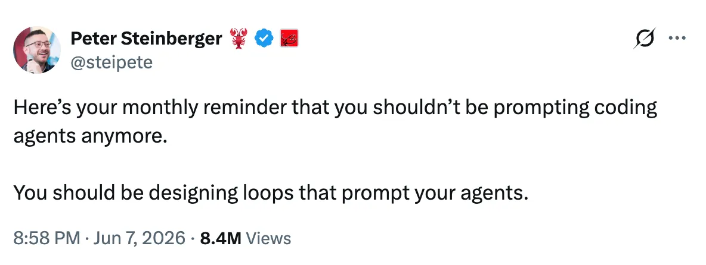

### Agents aren't just chatbots anymore.

It started out as copy-pasting ChatGPT code. Then the AI was completing code for you. Then it was just writing entire features itself. Before long it seemed to be doing everything.

Not just writing code, but understanding a problem, breaking it down into parts, delegating those parts, testing, validating, iterating, risk assessment - AI can do all this and more. As soon as you think "gosh, AI saved my time from doing X, but now I'm doing Y so much" - chances are, AI can do a pretty good job at Y, too.

### People aren't prompting anymore.

Boris Cherney, creator of Claude Code, [put it plainly](https://newsletter.pragmaticengineer.com/p/what-is-loop-engineering):

> I don’t prompt Claude anymore. I have loops running that prompt Claude and figuring out what to do. My job is to write loops.

Echoed by the creator of OpenClaw:

Jarred Sumner, too, generated over a million lines [rewriting Bun into Rust over 11 days](https://bun.com/blog/bun-in-rust) by using loops of agents, almost fully removed from this massive, high-impact refactor that is now stable on millions of developer machines.

These developers have figured out: the less you have to read, understand, figure out what to do next, direct the next agent, **the faster things churn.** In other words, **your throughput scales with how self-sufficient the loop is**, how far removed you are from it.

### How far can this go?

It's pretty wild how far some people have pushed the boundaries on engineering loops.

For a while, I thought the "final boss" of loop engineering was [Kun Chen](https://www.youtube.com/@kunchenguid), who uses **20-30 parallel sessions to ship over 40 PRs a day.** He's optimized and automted almost every part of his workflow - planning, verification, jugglgin sessions - accumulating an impressive 30K stars over his numerous open source projects in a span of a few months.

### Then I read [Jacob Sansbury's post on how they run Spawn.](https://x.com/jsnnsa/status/2115623382721126826)

The numbers don't seem real - **$32m/year** on tokens, for a team of **10 humans.** Apparently shipped **77,000 "substantial changes" in 30 days**, or 108 per hour. He calls them the "most AI-pilled company in the world".

I'd recommend reading for yourself; it makes the [hyperoptimized engineer](https://www.youtube.com/watch?v=MhEL9cvLxQE) not seem like a hyperbole anymore.

Some of the practices they've adopted in order to accomodate this breakneck speed are:
- **Abolish PRs.** Yes, they let the agents just push to main
- **Don't run the tests before deploying to production.** Too slow - they run the test suite on a 15-minute cycle.
- **Push now, fix later.** They *"check after it goes in and fix anything broken with a new change on top, instead of undoing and redoing work."*
- **Don't wait on the humans to approve or even ask for the work.** Then all work waits on them saying what broke or what features users want. They just skip the middlemen and let user bug reports go straight to production instead.
- **Automate even the decision-making.** At some point, the agents were coming up with judgment calls for Jacob to make faster than he can answer, so he automated that, too, in the form of "agent judges" that answer on his behalf based on past answers.

### Wow, that sounds... amazing? Terrifying?

These are all the exact opposite of the lessons and best practices the software engineering community has heralded in the past. You have to catch bugs and carefully verify before it goes out into the world, right? It costs far more to fix later than earlier, right?

Maybe agents are changing the economy at this fundamental level.

### But does it even work? Should we all start doing this?

Apparently it sounds like they're still figuring that out too. It's still so new and experimental, so it's hard to say if failures are just their little mistakes or if the approach itself is fundamentally flawed.

For instance, one of the messages Jacob sent was:

> This ruined chat????? REVERT IT pls claude

If the humans can really be that out of the loop, wouldn't the agents obviously be able to figure out they need to fix the chat? It still surprises me so much that for all the impressive things agents accomplish, they still have those dumb moments that need a human to steer them.

Jacob talks about needing the humans to drive riskier, sweeping changes too, instead of just the incremental 1%, 2%, 3% improvements.

### So it seems like, for now, humans are needed at least somewhere in the loop.

Even if we can automate away so much, at the end of the day, **there appears to be a limit**, at least with today's capabilities.

It's interesting to dream about the future though - a year from now, will agents be able to just orchestrate themselves, spending $32m/year making awesome features, with *zero* humans? I suppose time will tell.
